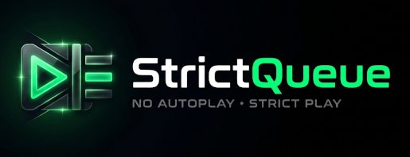
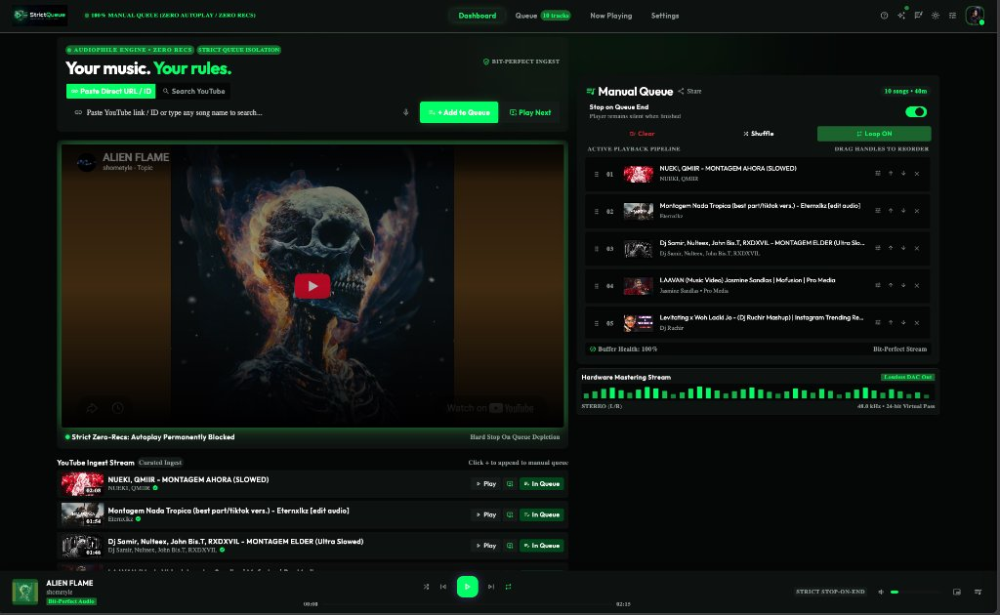
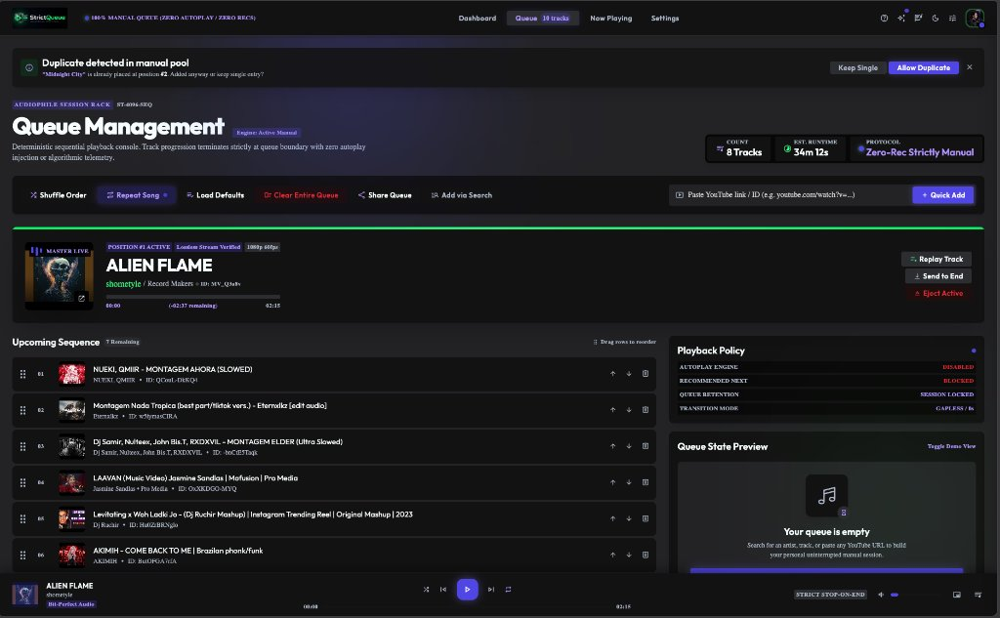
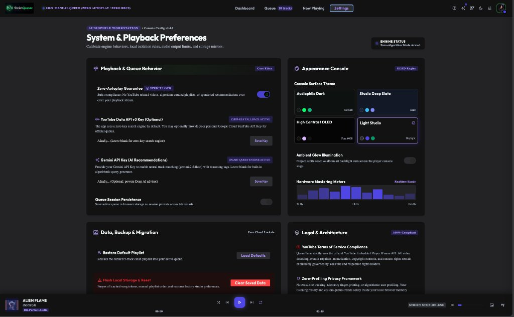

# StrictQueue (QueueTune v2.4 Studio)

<p align="center">
  
</p>

An audiophile web workstation and YouTube player built with an absolute **Zero-Autoplay Guarantee**: only songs explicitly queued by the user ever play, and audio halts with complete silence when the queue ends.

---

## Interface Overview

### 1. Main Dashboard
The command center featuring the dedicated video playback stage, live YouTube ingest stream, instant search/URL bar, bit-perfect volume mastering meters, and active playback controls.

<p align="center">
  
</p>

### 2. Queue Management
The deterministic sequential playback rack. Manage upcoming tracks, paste direct YouTube links or IDs (`+ Quick Add`), reorder rows with drag handles, configure loop/shuffle, and inspect duplicate detection alerts.

<p align="center">
  
</p>

### 3. System & Playback Preferences (Settings Panel)
Fine-tune playback behaviors, theme engines (Audiophile Dark, Studio Deep Slate, High Contrast OLED, Light Studio), ambient aura lighting, session persistence, zero-key/custom API settings, and backup exports.

<p align="center">
  
</p>

---

## Key Highlights

- **Strict Zero-Autoplay Engine**: Blocks algorithmic recommendations, related video feeds, and automatic continuations. Playback strictly follows the user queue.
- **Unified Track Normalization**: Handles YouTube links, manual video IDs, search queries, voice search, and backup imports with sanitized schemas.
- **Smart DJ Controls**: Per-track settings for custom intro skip (`startAt`), outro skip (`endAt`), playback rate (`0.85x` to `1.15x`), and volume gain leveling.
- **Real-Time Synced Lyrics**: Community lyrics synchronization powered by LRCLIB with line-by-line auto-scroll and jump-to-timestamp seeking.
- **Timestamp Drop Bookmarks**: Pin moments within tracks, attach tags, and jump directly to bookmarks.
- **Installable Desktop PWA & Picture-in-Picture**: Supports standalone PWA installation, hardware media keys (`navigator.mediaSession`), and Document Picture-in-Picture mode.
- **Privacy & Security Focused**: Zero cookies or tracking telemetry. Settings and queues persist in client `localStorage`.

---

## Project Structure

```text
├── index.html        # App interface and layout
├── app.js            # Core playback engine, state management, and UI logic
├── server.py         # Lightweight Python search proxy and static file server
├── sw.js             # Service Worker for PWA asset caching
├── manifest.json     # PWA Web App Manifest
├── icon.svg          # Application icon
├── logo.jpg          # Application branding artwork
├── vercel.json       # Production security headers and deployment configuration
├── _headers          # Cloudflare / Netlify HTTP security headers
├── .gitignore        # Git ignore rules
└── .env.example      # Example environment configuration
```

---

## Getting Started

### Prerequisites

- Python 3.8 or higher installed on your machine.

### Local Development

1. **Clone the repository:**
   ```bash
   git clone https://github.com/<your-username>/strictqueue.git
   cd strictqueue
   ```

2. **Start the local server:**
   ```bash
   python3 server.py
   ```

3. **Open the application:**
   Navigate to `http://localhost:8080` in your web browser.

---

## Deployment

The application is structured as static files with an optional backend search proxy. It can be hosted on platforms such as:

- **Vercel**: Deploy using the included `vercel.json` for security headers.
- **Netlify / Cloudflare Pages**: Deploy using the included `_headers` configuration.

---

## License

This project is open-source and available under the terms of the [MIT License](LICENSE).
